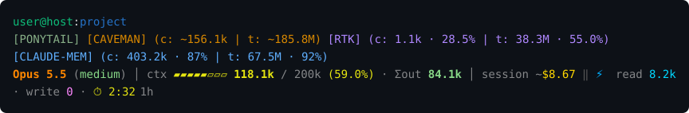
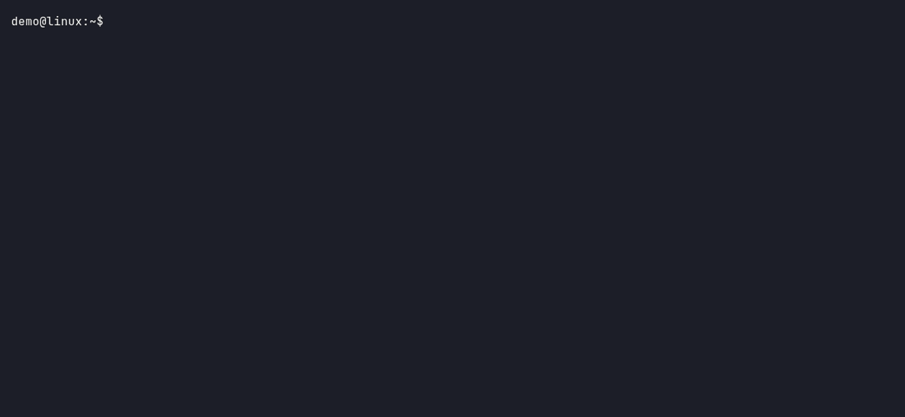
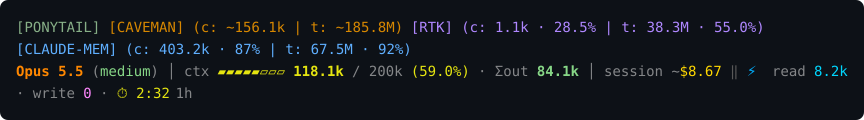

# Rainbow Statusline

One status line for AI coding assistants. It shows where you are, which plugins are active, the model, how full the context is, what the session costs and how long the prompt cache lives, in the same layout in Claude Code, Copilot CLI and OpenCode.



It is a single program with no runtime dependencies (no jq, sqlite3, bash, perl or Node). It sends nothing anywhere: the only network call is to the local claude-mem worker on `127.0.0.1`.

## Install

macOS, Linux and Windows are supported.

| System | Command |
|---|---|
| macOS, Homebrew | `brew install milczarekIT/tap/rainbow-statusline` |
| macOS or Linux, script | `curl -fsSL https://raw.githubusercontent.com/milczarekIT/rainbow-statusline/main/install.sh \| sh` |
| Windows, Scoop | `scoop bucket add milczarekIT https://github.com/milczarekIT/scoop-bucket` then `scoop install rainbow-statusline` |
| Windows, script | `irm https://raw.githubusercontent.com/milczarekIT/rainbow-statusline/main/install.ps1 \| iex` |
| Any, from source (Go 1.27 or newer) | `go install github.com/milczarekIT/rainbow-statusline/cmd/rainbow-statusline@latest` |
| Any | download the archive for your system from the GitHub Releases page and put `rainbow-statusline` on your PATH |

The scripts check the download against `checksums.txt` before installing and refuse on a mismatch. The checksum protects against a corrupted or truncated download, not against a compromised release: the checksum file comes from the same place as the archive. They install for the current user only (`~/.local/bin` on macOS and Linux, `%LOCALAPPDATA%\Programs\rainbow-statusline` on Windows), never use sudo, and tell you what to do about PATH: on macOS and Linux they print the line to add to your shell profile, on Windows they add the folder to your user PATH and say so.

## First run

Run the program with no arguments in a terminal:

```
rainbow-statusline
```

Use Windows Terminal on Windows; it is the supported terminal. Under Git Bash or mintty a bare run sees no terminal on stdin and waits there; press `Ctrl+C` to leave.

The first time, a short guide lists the assistants it finds, lets you pick which items to show and how dense the line is, and shows a live preview. Nothing in your assistants' settings changes until you confirm, and every file is backed up first. If an assistant already has a different status line, the guide shows it and asks before replacing it. Afterwards the same command opens a single configuration screen with a list of items and a live preview; `s` saves.



### Density

Full shows up to three lines; the plugin row appears only when there are badges:


Compact drops the user and directory:



Minimal keeps one line with the model, context and cost:


The longer lines are wrapped here to fit the page.

## What works where

| Item | Claude Code | OpenCode | Copilot CLI |
|---|---|---|---|
| Model | yes | yes | yes |
| Effort | yes | variant, when set | — |
| Context (tokens, bar, %) | yes | yes | yes |
| Σout (output tokens) | yes | yes | — |
| Session cost | yes | yes | — (no USD cost) |
| Cache read / write | yes | yes | — |
| Cache timer | yes | estimated (`⏱ ~`) | — |
| Ponytail, Caveman | yes | yes | never shown |
| RTK, claude-mem session `c:` | yes | yes | — |
| RTK, claude-mem total `t:` | yes | yes | from the machine-wide data, when installed |
| Verified on macOS | figures checked on real session data | figures checked on real session data | through real samples of its input |
| Verified on Linux (Ubuntu 24.04) | through real samples of its input | through real samples of its input | through real samples of its input |
| Verified on Windows | not yet | not yet | not yet |

A dash (`—`) means the assistant does not provide the value or it could not be read. A value that is not a measurement carries a `~`. A percentage outside 0–100, a negative count, an unreadable value, more than a trillion tokens, more than a million USD, or a `t:` total smaller than its `c:` session figure is shown as `—`, never clamped. Windows support is built and unit-tested, but the real assistants have not yet been run there, so treat it as unverified until this table says otherwise.

## Where every field comes from

| Field | Formula and source |
|---|---|
| `user@host:dir` | Operating system user and host name; the assistant's working directory. |
| Model, effort | The assistant's own model name and effort level (OpenCode: its variant). |
| `ctx` | Tokens in use over the context size. Used tokens are the latest call's input plus cache read plus cache write. The percentage is the assistant's own figure when it is within 2 points of used/size, otherwise used/size. Green below 50%, yellow below 80%, red from 80%. |
| `Σout` | Output tokens summed over the session: the largest output count seen per message in the Claude Code transcript (subagents included), or the sum over messages in OpenCode. |
| `session ~$` | The assistant's own running cost in USD (Claude Code `cost.total_cost_usd`; OpenCode: sum of message costs). It is an estimate, hence the `~`. Copilot reports no USD cost. |
| `⚡ read / write` | Cache read and write tokens of the latest call (Claude Code, OpenCode). Copilot reports only session totals, so it shows `cache —`. |
| `⏱` | Time left on the prompt cache, from the assistant's own expiry (Claude Code). OpenCode gives no expiry, so it is the last reply plus five minutes and is marked `~`. Yellow in the last 40% of the cache life, red in the last minute, `✖ expired` after. The suffix `5m` or `1h` is the cache life. |
| `[PONYTAIL]`, `[CAVEMAN]` | The plugin's own mode flag file. The badge is hidden when the plugin is missing or off. |
| RTK `c:` | Tokens saved and percentage for this session: rows of RTK's `history.db` matched to the session through RTK's hook decisions (Claude Code) or the session's bash commands (OpenCode). |
| RTK `t:` | All-time saved and input tokens from `rtk gain -f json`, and their ratio. |
| claude-mem `c:` | The `work \| saved` line claude-mem injected into this session: read from the transcript (Claude Code) or from the local worker at `127.0.0.1:37777` (OpenCode). |
| claude-mem `t:` | claude-mem's own formula over its database: saved = sum of `discovery_tokens` minus the tokens needed to read the observations (about one token per four characters); work = sum of `discovery_tokens`; the percentage is saved over work. It is a potential, not a measurement, and is shown without `~`. |
| Caveman `c:` / `t:` | Only in `full` mode: output tokens × 0.65 / 0.35 for the session and for all sessions. This is an estimate from Caveman's benchmark ratio, so both numbers carry `~`. |

A missing RTK or claude-mem shows `[RTK off]` or `[CLAUDE-MEM off]`. Ponytail and Caveman simply disappear.

### Cold start

The `t:` totals are computed in the background and cached for a minute, so drawing never waits on them. The very first draws after install show `—` for them, and the Caveman `t:` total, which reads all past transcripts, can take a few minutes to appear on a large history.

## Uninstall

Run this first, while the program is still installed:

```
rainbow-statusline uninstall
```

It removes only the entries it added to your assistants' settings and restores the status line you had before. It leaves the program's own files, so running `rainbow-statusline` again opens the configuration screen, and `s` installs it again:

| | macOS | Linux | Windows |
|---|---|---|---|
| Configuration, install state and backups (`state/`, `state/backups/`) | `~/Library/Application Support/rainbow-statusline` | `~/.config/rainbow-statusline` | `%APPDATA%\rainbow-statusline` |
| Cache | `~/Library/Caches/rainbow-statusline` | `~/.cache/rainbow-statusline` | `%LOCALAPPDATA%\rainbow-statusline` |

Delete those folders to remove everything. Then remove the package:

```
brew uninstall rainbow-statusline            # macOS, Homebrew
scoop uninstall rainbow-statusline           # Windows, Scoop
```

If you used a script, delete the file it printed (`~/.local/bin/rainbow-statusline`, or the install folder on Windows, and its entry in your user PATH). Removing the package first leaves your assistants pointing at a program that no longer exists; run `uninstall` before removing it.

## License

MIT, see [LICENSE](LICENSE).
